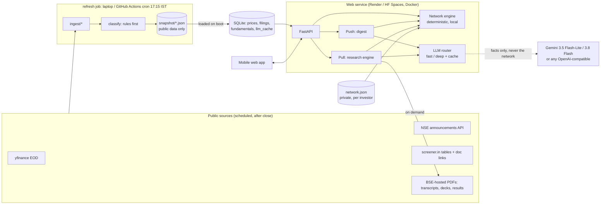

# FINN — architecture and writeup

## What I built, in one paragraph

FINN is an analyst that briefs you, not a dashboard you read. The Brief opens with a sentence ("Five things need you."), and how much space an item gets is how much it matters: full cards for the few that need action, single rows for the ones worth knowing, and one folded line for routine paperwork. Every important card ends with a person. For a new CFO, it shows their career and the route to them through your network. For an acquisition, it shows who has worked at the company, a competitor or a customer. For litigation, it adds a lawyer from your expertise map, and it flags anyone who is a current insider, so you remember to stay on public information (SEBI insider-trading rules on unpublished price-sensitive information, "UPSI"). The research view leads with *Did management deliver?* rather than a summary, because that question separates analysing management from repeating them.

## System diagram

## Data pipelines

| Data | Fetched from | When | Stored | Linked by |
|---|---|---|---|---|
| EOD price and volume | yfinance (`SYMBOL.NS`) | daily after close | `prices(symbol, date)` | NSE symbol |
| Announcements | NSE `/api/corporate-announcements` (cookie warm-up, polite rate limit) | daily, 7-day lookback, idempotent | `filings(id)`; classification cached in the row | symbol, then org id |
| Fundamentals | screener.in company page (consolidated, falls back to standalone) | daily for holdings, on demand for anything else | `fundamentals(symbol)` JSON, 20h TTL | symbol |
| Primary documents | PDF links listed on screener (BSE-hosted) | on demand | text per page, cached forever (filings are immutable) | URL |
| People | investor's own LinkedIn export + notes (here: synthetic) | on import | `network.json`, separate from market data | org and school resolution |

**Linking a name in a filing to a person in the network** is the hard join. There are three steps, from cheapest to most expensive:
1. **Org resolution.** Normalise the name (strip Ltd/Limited/Pvt, a trailing "India", punctuation), look it up exactly in an alias table, and only then try fuzzy matching (token-set ≥ 92). "Dixon Technologies (India) Limited", "Zomato Ltd" and "Havells India Ltd." all resolve.
2. **Person resolution.** Strip honorifics and suffixes ("Mr.", "Dr.", ", CA"). A name match alone is capped at "possible" and needs a shared organisation to count as "same person". India has a lot of Rahul Sharmas.
3. **Relationship inference.** Two careers "touch" when they share an employer with overlapping years (stronger if it's the same function, and weaker the longer ago it ended) or a school with the same batch. Explicit "X knows Y" edges beat inferred ones.

**Where the incoming CFO's bio comes from.** SEBI disclosure rules require a *brief profile* of an appointed director or key managerial person inside the filing itself. So the bio comes from a primary source: the fast model turns that paragraph into a structured career, and no profile scraping is needed. LinkedIn enrichment would be an optional extra step through a licensed provider.

**Why the brief is anchored to the data, not the clock.** The window ends at the newest filing we hold. A snapshot refreshed last night still gives a sensible "last 24 hours" this morning.

## Use of LLMs and agents

One principle: **the model is an upgrade, never a dependency.** Every step has a deterministic path, and the app runs end to end with no key. The model is used only where language understanding is the bottleneck.

| Step | What does it | Why |
|---|---|---|
| Classify filings | Regex on NSE's own subject plus text keywords. The fast model only sees the leftover ambiguous ones ("Updates", "Outcome of Board Meeting" with no signal) | NSE already labels most filings. Rules are instant, free and explainable. Measured on the live 15 Nov 2026 refresh: **21 of 34 filings (62%) classified with no model call** (18 by NSE's subject, 3 by text keywords); the other 13 go to the fast model. |
| Materiality | Additive Python score | An investor can read the breakdown ("Why this is here") and disagree with it |
| One-line summary | Clean the boilerplate first; the fast model rewrites only Act/Know items; cached in the row | Routine items never cost a token |
| Bio from a management-change filing | Fast model → JSON career | Messy prose to a structure is exactly what small models do well |
| Results Revenue/EBITDA/PBT/PAT | Python over the standardised quarterly table; fast-model PDF extraction only as a fallback, labelled "verify" | A model should never be the source of a reported number |
| Guidance extraction | Regex pre-filter → the fast model *selects sentence IDs* | The model never writes a quote, so every quote is verbatim with its page number by construction. The model reads at most 40 sentences instead of the whole transcript |
| Promised vs delivered | Python for revenue growth and margins; the deep model only for non-mechanical items, given the computed facts | Arithmetic belongs in code; judgement belongs in the model |
| Bull / bear | Deep model, only from a numbered facts pack, and it must cite fact IDs; uncited points are dropped | Keeps the model on primary data, as the brief requires |
| Business mix | Fast model over the relevant investor-presentation pages only | Chunk selection before the call |
| Network matching | **No model.** Deterministic Python | Privacy, and an explainable "why" |
| Reconnect draft | Fast model gets a first name and the public reason, nothing else | Data minimisation |
| Ask routing | Rules; the fast model only if no entity is found | Most queries are a ticker or a name |

**Models.** Two tiers, set by environment variables. Defaults are `gemini-3.5-flash-lite` (fast) and `gemini-3.8-flash` (deep), because the free tier covers this prototype; the 2.5 generation is on Google's deprecation list. Both are overridable with `FINN_LLM_FAST` / `FINN_LLM_DEEP`. Any OpenAI-compatible endpoint also works (Groq, OpenRouter, local Ollama). Production would A/B a stronger deep model for the credibility verdict, since that's where quality is worth paying for.

**Cost controls.** Rules before models (62% of live filings never reach a model); the fast tier by default; a content-addressed cache (sha256 of model + prompt) so nothing is paid for twice, which suits immutable filings and transcripts; sentence pre-filtering; research results cached per symbol per day. `/api/meta` reports calls, cache hits and estimated input tokens.

**Agents.** Deliberately minimal. The refresh job is a fixed pipeline, not an agent. The research engine is a deterministic plan with model calls at fixed points, which makes it predictable, cheap and testable. Where an agent would earn its place next: a "dig deeper" mode that decides which annual-report sections to pull, for example when receivables jump, read the notes on related parties and contingent liabilities.

## Data security and privacy

- **Separation.** Public market data (shareable across users) and the investor's network (private) live in different stores. The snapshot that gets committed and deployed holds public data only.
- **The network never goes to a model.** All matching is local Python. The single model call involving a person (the reconnect draft) sends a first name and a public news hook.
- **What's stored.** For each contact: name, career, education, how you met, a strength score, last contact date. Emails are dropped on import. Nothing is scraped; data enters only through the investor's own export or their own notes.
- **Retention.** For people seen only in filings (not contacts), only the extracted career is kept, alongside the filing. In production these profiles would expire (say 12 months) unless the person is promoted into the network.
- **Access.** The prototype has a shared-secret gate (`FINN_ACCESS_TOKEN`, stored as an httpOnly cookie). Production: SSO login; one encrypted store per investor (or Postgres row-level security keyed on investor id); KMS-managed keys; an audit log of who viewed which person.
- **Consent.** People in the network didn't sign up to FINN. So the system only processes what the investor already legitimately holds, offers export and deletion, never shares one investor's network with another, and shows nothing about a contact that the contact hasn't made public or told the investor.
- **Compliance in the product.** Current insiders at listed companies get a UPSI caution wherever they're suggested as someone to call.

## Cloud services

| Piece | Where | Why |
|---|---|---|
| Web app + API | One Docker container on Render free tier (or Hugging Face Spaces) | One process serves the API and the static UI: no CORS, one URL to share |
| Database | SQLite inside the container, rebuilt from the snapshot on boot | Zero ops; the container is stateless. Production: managed Postgres |
| Ingestion | GitHub Actions cron at 17:15 IST, or a laptop | Free, versioned, and the data diff is visible in git. NSE blocks many cloud IPs; if the runner is blocked, run the same command locally |
| Models | Gemini API (free tier) | Cheap fast tier, good JSON mode |

## What I deliberately left out

- Real LinkedIn data. It's against LinkedIn's terms to scrape; the consent-friendly route (the user's own export) is supported instead.
- Intraday data and push notifications. The brief specifies end-of-day data; a PWA web-push hook is the next step.
- A full annual-report reader (200+ pages). The research view gets its depth from transcripts, standardised statements and the investor deck at a fraction of the tokens.
- Learned ranking. Weights are hand-tuned and visible; they should be learned from what the investor opens versus dismisses.
- Multi-user auth. One investor, one token.

## Where I'd take it next

1. **Learn the materiality weights** from opens and dismissals (logistic regression on category, text signals, position size and network presence).
2. **Annual-report deep reads** on demand: auditor qualifications, related-party transactions and contingent liabilities, compared year on year.
3. **Network from the investor's calendar and email** (with consent), so "last spoke" is real and warmth stays current without effort.
4. **Meeting prep mode**: before a calendar meeting with management, push the diligence card plus the open guidance items to ask about.
5. **Evaluation harness** for the model steps: a labelled set of 200 filings for classification precision and recall, and 20 transcripts with hand-marked guidance, to choose models on measured accuracy per rupee.
